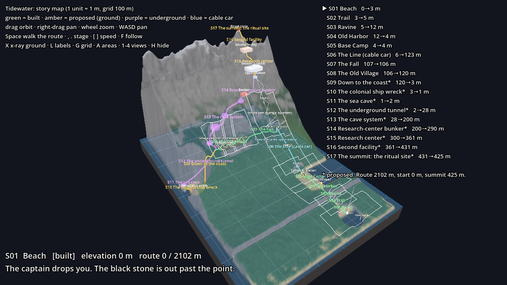
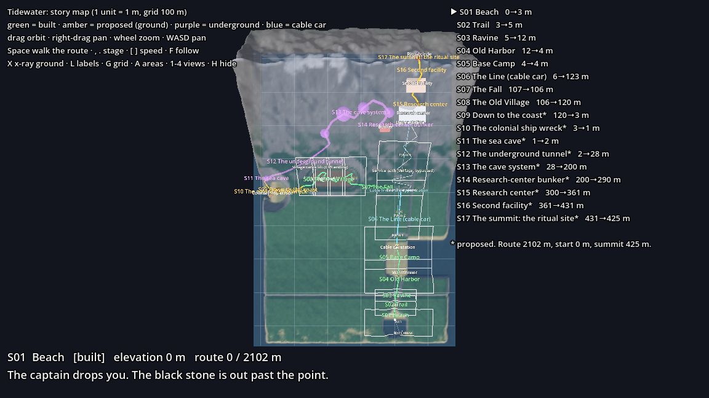
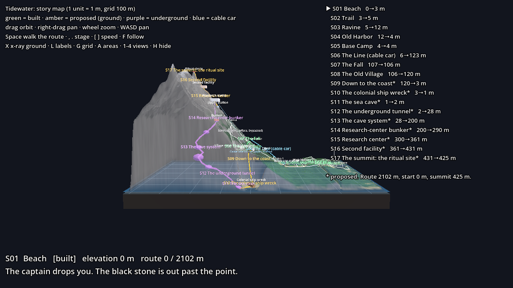
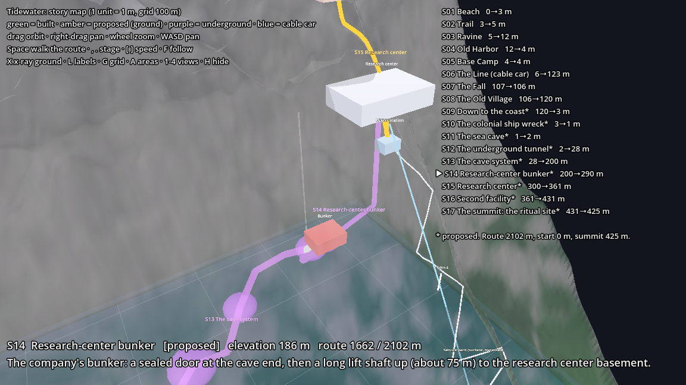

# Tidewater — Story Map

> **PROPOSED (2026-10-16).** This is the player's route through the whole island, from the beach to the summit. Stages 1–8 are built (levels exist). Stages 9–17 are this map's suggestion from your notes: **nothing is built, no chapter docs exist for them, and every number can change.** The data lives in [`map.json`](map.json); the 3D miniature reads it, so edit the file and look again.



## The route in one line
```
Beach → Trail → Ravine → Old Harbor → Base Camp → Cable car → The fall → Old Village
   → down to the coast → Colonial ship wreck → Sea cave → Underground tunnel → Cave system
   → Research-center bunker → Research center → Second facility → Summit: the ritual
```
You start at sea level, climb to 106 m (the village), **drop back to sea level** at the wreck, go **under the mountain** through the tunnel and caves, and come up inside it to the research center (300 m), then the second facility (360 m) and the summit (430 m).

## Stages
`Chapter` is the existing chapter, where there is one. Area numbers for stages 9 to 17 are **proposed** (one scene per area, as now). Lengths are the through-route only (the line on the map), not every step the player walks in a room, so real play is longer. Elevations are metres above sea level.

| # | Stage | Where | Status | Chapter | Areas | Route | Elevation | Gets you out by |
|---|-------|-------|--------|---------|-------|-------|-----------|-----------------|
| S01 | Beach | south shore | built | 1 | A01 | 34 m | 0 → 3 | the trail |
| S02 | Trail | forest, inland | built | 1 | A02 | 30 m | 3 → 5 | fallen tree, wall, shrine |
| S03 | Ravine | cliff crossing | built | 1 | A03 | 35 m | 5 → 12 | scaffold; **it collapses: no way back** |
| S04 | Old Harbor | fenced yard | built | 1 | A04 | 73 m | 12 → 4 | cut the gate chain |
| S05 | Base Camp | supply depot | built | 2 | A05 | 57 m | 4 | power the cable car |
| S06 | The Line | cable car up the mountain | built | 3 | A06 | 200 m | 6 → 123 | the car stops; climb down the pylon ladder |
| S07 | The Fall | pylon 3 → the hollow | built | 3 | A06/A07 | 155 m | 107 | a rung gives way; **no way back up** |
| S08 | The Old Village | sunken hollow, west slope | built | 4 | A08–A11 | 234 m | 106 → 120 | *proposed change*: the south-west rim gap (see conflict 1) |
| S09 | Down to the coast | gully, west side | proposed | | A12 | 192 m | 120 → 3 | steep and loose: **one way** |
| S10 | Colonial ship wreck | the cove, west coast | proposed | | A13 | 56 m | 3 → 1 | through the hull, then wade along the waterline |
| S11 | Sea cave | cliff foot, from the water | proposed | | A14 | 30 m | 1 → 2 | inward, away from the sea |
| S12 | Underground tunnel | under the west slope | proposed | | A15 | 196 m | 2 → 28 | meets the cave system |
| S13 | Cave system | inside the mountain | proposed | | A16–A18 | 364 m | 28 → 200 | the longest climb: about 170 m up |
| S14 | Research-center bunker | under the research center | proposed | | A19 | 154 m | 200 → 290 | a sealed door, then a lift shaft (about 75 m) |
| S15 | Research center | top of the cable line | proposed | | A20–A21 | 154 m | 274 → 361 | service road up |
| S16 | Second facility | between the center and the summit | proposed | | A22 | 92 m | 361 → 431 | steps / funicular up |
| S17 | Summit: the ritual site | top of the mountain | proposed | | A23 | 6 m | 431 | the finale |

Total through-route: about **2.1 km**, of which about 0.7 km is underground (S11–S14).

## Length
**Decision (2026-10-16): a longer game is wanted; no need to squeeze it to 90 minutes.** Rough estimate at the density already built (puzzles, exploring, reading): about **2.5 to 3.5 hours** for the whole route. The built stages (S01–S08) are about 50 to 75 minutes of that. This is a guess from the previs lengths times 2 to 4, not a playtest; revisit it once a stage is playable.

## Where things are
Coordinates are the game's world metres: x east, **z south (up the mountain is negative z)**, y up. The grid in the miniature is 100 m.

| Place | x, z | Notes |
|-------|------|-------|
| Beach landing | 0, 66 | built |
| Old Harbor gate | 10, −80 | built |
| Cable car lower station | 5, −140 | built |
| Pylon 3 / car stops | 5, −305 | built |
| Old village (floor) | −140 … −240, −335 | built; floor 105 m |
| Village west rim (the exit gap) | −258, −315 | proposed |
| The cove and ship wreck | −355, −300 | proposed; the real terrain has **no coast there yet** |
| Sea cave mouth | −388, −334 | proposed; at the waterline |
| Cave system | −60 … −205, −440 … −545 | proposed |
| Bunker | −45, −455, y 214 | proposed |
| Research center | 10, −470 | proposed; surface 300 m |
| Second facility | 10, −520 | proposed; surface 360 m |
| Summit ritual circle | 5, −560 | proposed; surface 430 m |

## Seeing it
| View | |
|------|---|
|  | **Plan.** The built areas are the white boxes. The proposed route bends west at the village, goes round the coast and then under the mountain, and comes back east to the summit. |
|  | **Profile from the west.** Purple is underground. Note the drop from the village (106 m) to sea level, then the climb through the mountain. |
|  | **Underground detail** at the bunker. The research center sits 75 m above it. |

## How the player moves
- **Mostly one-way.** Points of no return: the ravine scaffold (S03), the ladder fall (S07), the gully down to the coast (S09). The player never backtracks to the beach, the camp or the cable line.
- **The big shape is a horseshoe.** Up the mountain (S06–S08), **down to sea level** (S09–S11), then up *through* the mountain (S12–S14), then up *over* it (S15–S17). That means the story has three different "up" feelings: cable car, caves, summit.
- **Sea level is the middle of the game.** The wreck, sea cave and tunnel are the lowest, darkest part, right after the village. The summit is visible from every outdoor stage, so it can pull the player on.
- **Light and sound along the route.** Outdoors: the lit path above (the owner's lamps). In the village: no power, so the owner is silent. In the tunnel and caves: ideas only, see below.

### Who can reach the player where (proposals)
| Place | The creature (the Shepherd) | The owner (power) |
|-------|------------------------------|-------------------|
| Harbor, camp, cable line | glimpses | yes (lamps, gates, generator) |
| Village | yes (the colonist's home) | **no** (no power) |
| Wreck | yes (his ship) | no |
| Sea cave, tunnel | tracks it | only if the company lit the tunnel |
| Cave system | the god's place: neither feels welcome | no |
| Bunker, research center, facility | rarely | **yes** (everything runs on power) |
| Summit | the finale | yes |

### Shortcuts that would let the world loop (ideas, not decisions)
- The cable car, once powered again from the research center, takes the player down to camp.
- The village cargo lift (built in Ch4) goes up to the service path: a late shortcut from the village.
- The bunker door can only be opened from the research-center side, so the cave route becomes a one-way gate.

## Conflicts with what is already written (please decide)
1. **Chapter 4 ends on the cargo lift up to the service path, but you now want the village to lead to the wreck.** This map makes the village exit the south-west rim gap, and leaves the lift as a built-but-unused shortcut. The Ch4 previs is **not changed**. Options: keep the lift as a *false* exit (it jams, or it leads up to a dead end), or move the lift to a later shortcut.
2. **The lit path, stream and forest (Ch3 beats 7–9, drawn as the "service path (surface, bypassed)" line).** In this route the player never walks it; they reach the research center from below. Do you want that path cut, kept as an optional route, or used in the finale?
3. **The research center now has two entrances.** The cable car (Ch2–3 promise "the car takes you to the research center") and the underground bunker. Which one does the player earn?
4. **`BACKSTORY.md` puts the ritual in "the research center and the chamber".** You now say the ritual is on the summit. That needs a backstory edit: where was the three-crystal circle opened (the village ring in the old festival, the summit, or both)? And the "sandbar where Elias went" has no place on this map yet.
5. **The hollow under the island comes back.** It was cut from Ch2 (Elias's blast hatch at the harbor, "the hollow runs under the whole island"). The cave system is a natural home for it, and the hatch at (6, −129) could be a *second* way in. Do you want that connection?
6. **Terrain does not exist yet** for the west coast, the cove, the sea cave, the summit or the north slope. The miniature invents them in `game/map/island_height.gd`. Building the levels would mean adding those to the real height function in `tools/build_common.gd`.

## Open questions
- The **second facility**: what is it, and who is in it? (Notes say "another facility"; the map just calls it that.)
- The **colonial ship**: is the wreck the Shepherd's (the colonist's) ship, so the player learns his story at its source, or the company's?
- The **sea cave** from the water: does the player swim or take a boat? Is there a tide puzzle?
- The **tunnel**: man-made by the colonist, by the company, or both? That decides whether the owner can reach it.
- Does the **summit** include an inside (a chamber in the crater), or is it all outdoors?
- How many chapters? A suggestion: S09–S11 one chapter, S12–S13 one, S14–S15 one, S16–S17 the finale, but that is only a grouping idea.

## Using the miniature
Open the model (any folder):

```bash
/Applications/Godot.app/Contents/MacOS/Godot --path "/Users/tharumagulasingamupenthiran/Documents/GameIdea/island horror game /godot" res://game/map/island_miniature.tscn
```

Note the trailing space in `island horror game `, and keep the quotes.

| Control | |
|---------|--|
| Left-drag, right-drag, wheel | orbit, pan, zoom (WASD also pans, Q/E down/up) |
| `Space` | a white marker walks the whole route; `[` `]` change speed; `F` follows it |
| `,` `.` | previous / next stage (frames it) |
| `X` | ground see-through or solid |
| `L` `G` `A` | labels, 100 m grid, built-area outlines |
| `1` `2` `3` `4` | top, iso, south, west views |
| `H`, `Esc` | hide panels, quit |

Colours: **green** = built surface, **amber** = proposed surface, **purple** = underground, **blue** = cable car, **white** lines = the built areas A01–A11.

To plan a change: edit [`map.json`](map.json) (the route points are `[x, z]` on the ground, or `[x, z, y]` at a fixed height), save, and open the model again. To print the stage table: add `-- --report` after the scene path with `--headless`. Screenshots: see the header of `game/map/island_miniature.gd`.

Files: `story/map.json` (data), `game/map/island_miniature.tscn` + `.gd` (viewer), `game/map/island_height.gd` (the miniature's terrain), `story/map_views/` (the pictures above).
