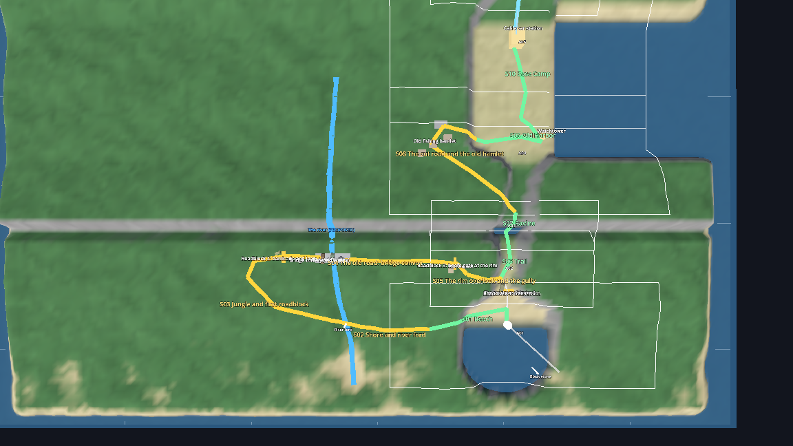
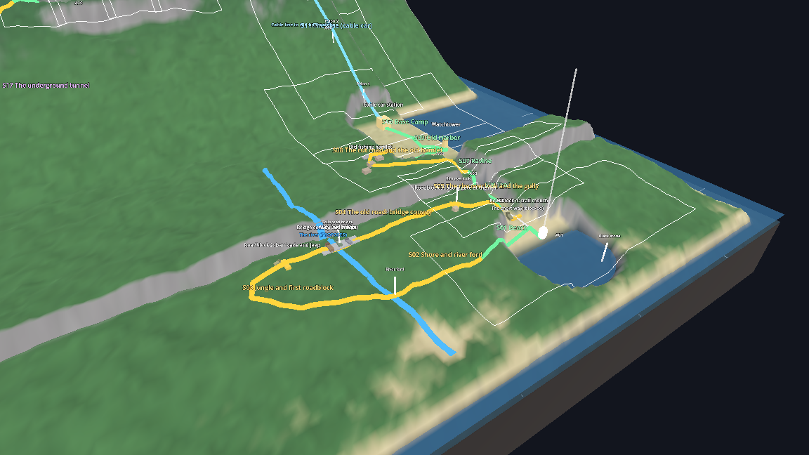

# Tidewater — Story Map & Level Route (2.5-Hour Cosmic Horror)

> **Updated (v8).** This is the player's complete route through the island, from the southern beach landing to the summit ritual crater. Stages `S01–S08` (plus `A07` Service Path) are built in Godot. Stages `S09–S17` (Chapters 5 & 6) complete the 2.5-hour (150-minute) cosmic horror arc. All spatial data lives in [`map.json`](map.json) and is rendered in 3D by `game/map/island_miniature.tscn`.
>
> **Also PROPOSED (2026-10-16, not in any chapter yet):** the jungle loop `S01a–S01d` and the hamlet detour `S03a`, which lengthen the run from the beach to the first ladder and the harbor. They use sub-numbers so every `S01–S17` reference in the story docs stays valid. See [Proposed inserts](#proposed-inserts-the-jungle-loop-and-the-hamlet-detour).


---

## The Route in One Line
```
Beach → [shore & river ford → jungle → old road convoy → rim overlook] → Trail → Ravine
   → [cut road & old hamlet] → Old Harbor → Base Camp → Cable Car → The Fall → Old Village (Cargo Lift)
   → Lit Service Path (Bridge Ambush) → West Gully → Wreck of HMS Madrigal → Sea Cave
   → Smuggler's Tunnel → Abyssal Caverns (Deep Chorus) → Sub-Level Bunker B (Elias & Stone #3)
   → Research Center → Neural Siphon Facility (Vane's Body) → Summit Crater: The Ritual Circle
```
Brackets are the proposed inserts. You start at sea level (`0 m`), climb by cable car to `120 m` (the Old Village & Service Path), **plummet back to sea level (`1 m`)** at the 1784 shipwreck when The Shepherd collapses the stream bridge, ascend **inside the hollow mountain** through the Abyssal Caverns of the Deep Chorus to Bunker B (`214 m`), take the freight elevator into the Research Center (`300 m`), confront Vane's mutating body in the Neural Siphon Facility (`360 m`), and reach the Summit Crater (`430 m`).

---

## Stages & Pacing (150 Minutes Total)

| # | Stage | Where | Status | Ch | Areas | Est. Time | Route | Elevation | How You Progress |
|---|-------|-------|--------|----|-------|-----------|-------|-----------|------------------|
| **S01** | Beach | South shore | built | 1 | A01 | 4 min | 34 m | 0 → 3 m | Follow the overgrown trail inland (*insert proposal: the trail mouth is blocked, leave west along the shore*) |
| *S01a* | Shore and river ford | Shore, river mouth | proposed (insert) | 1 | TBD | — | 65 m | 9 → 8 m | Roadblock 1 shuts the trail mouth; wade the ford |
| *S01b* | Jungle and first roadblock | West plateau | proposed (insert) | 1 | TBD | — | 123 m | 8 → 18 m | Winding jungle path to an old barricade and jeep |
| *S01c* | The old road: bridge convoy | West plateau | proposed (insert) | 1 | TBD | — | 127 m | 18 m | Cross the collapsed bridge through the wrecked convoy to a boom gate |
| *S01d* | Rim overlook and the gully | Plateau edge | proposed (insert) | 1 | TBD | — | 45 m | 18 → 3 m | First view of the whole island; gully down to the trail |
| **S02** | Trail | Pine forest | built | 1 | A02 | 4 min | 30 m | 3 → 5 m | Crouch under tree, climb wall, inspect 3-hollow shrine |
| **S03** | Ravine | Cliff crossing | built | 1 | A03 | 3 min | 35 m | 5 → 12 m | Rotten scaffold (**collapses behind you: no way back**) |
| *S03a* | The cut road and the old hamlet | West wall, north of the ravine | proposed (insert) | 1 | TBD | — | 138 m | 12 → 4 m | Landslide cuts the road; climb to the hamlet, drop into the harbor yard from the west |
| **S04** | Old Harbor | Fenced yard | built | 1 | A04 | 9 min | 73 m | 12 → 4 m | Shed scare, climb tower for Reyes's cutters, cut gate chain as Black Stone rises |
| **S05** | Base Camp | Supply depot | built | 2 | A05 | 25 min | 57 m | 4 m | Hide from Shepherd in barracks, fuel generator, throw breakers, board Car 2 |
| **S06** | The Line | Cable car | built | 3 | A06 | 10 min | 200 m | 6 → 123 m | Shepherd races the slope; Elias's sabotage stops Car 2 at Pylon 3 |
| **S07** | The Fall | Pylon 3 ladder | built | 3 | A06/A07 | 5 min | 155 m | 123 → 106 m | Ladder rung snaps (**point of no return into the village hollow**) |
| **S08** | The Old Village & False Path | Sunken hollow + Service path | built | 4 | A08–A11 + A07 | 30 min | 234 m | 106 → 120 m | Decode carvings & 1784 log, survive Vane's false code, get **Pale Shard**, ride lift to Service Path; **Shepherd smashes stream bridge** |
| **S09** | West Gully | West cliff chute | proposed | 5 | A12 | 4 min | 192 m | 120 → 3 m | Steep scree slide from collapsed bridge down to West Cove (**one-way**) |
| **S10** | Wreck of *HMS Madrigal* | West Cove surf | proposed | 5 | A13 | 8 min | 56 m | 3 → 1 m | Tidal gun-deck puzzle, Capt. Locke's melted iron cage, Elias's pack |
| **S11** | The Sea Cave | Cliff waterline | proposed | 5 | A14 | 4 min | 30 m | 1 → 2 m | Wade through surf past Locke's 1784 crew calcified into the cave walls |
| **S12** | Smuggler's Tunnel | Under west slope | proposed | 5 | A15 | 6 min | 196 m | 2 → 28 m | Hide in submerged water alcoves; use **Pale Shard** at totem to blind Shepherd |
| **S13** | Abyssal Caverns (Deep Chorus) | Inside the mountain | proposed | 5 | A16–A18 | 8 min | 364 m | 28 → 200 m | 170 m climb past petrified villagers & the Sleeper's Eye below; harmonic bridge puzzle |
| **S14** | Sub-Level Bunker B | Under Research Ctr | proposed | 5 | A19 | 5 min | 154 m | 200 → 290 m | Find dying **Sgt. Elias**, receive **Tide-Stone #3**, hear Vane drop his mask, ride 75 m lift |
| **S15** | Research Center | Upper cable station | proposed | 6 | A20–A21 | 10 min | 154 m | 290 → 361 m | Mara's Acoustics Lab; survive Vane's automated locks/gas + Shepherd; pull server fuses |
| **S16** | Neural Siphon Facility | Below the crater | proposed | 6 | A22 | 8 min | 92 m | 361 → 431 m | Confront **Julian Vane's mutating body** in the Faraday Pod; set Siphon Routing Console |
| **S17** | The Summit: Ritual Crater | Peak caldera | proposed | 6 | A23 | 7 min | 6 m | 431 m | The open Void Halo, final Shepherd stand, and the **3 Cosmic Horror Endings** |

Total through-route: **~2.1 km** (~0.7 km underground in `S11–S14`). With the proposed inserts: **~2.65 km**, and roughly **+25–40 min** on top of the 150-minute budget (insert area numbers are TBD because `A12–A23` are taken by Ch5–6).

---

## Seeing It
| View | Description |
|------|-------------|
|  | **Plan.** Built areas are the white boxes (`A01–A11`). The route climbs to the village, plunges west to the 1784 shipwreck, burrows north-east under the mountain through the Abyssal Caverns, and rises through Bunker B into the Research Center, Siphon Lab, and Summit. |
|  | **Profile from the west.** Purple is underground (`S11–S14`). Note the dramatic drop from `120 m` (Village/Service Path bridge) down to `1 m` (Shipwreck) before the 430 m climb inside and over the mountain. |
|  | **Underground detail** at Sub-Level Bunker B (`S14`). The Research Center sits `75 m` above it at the top of the freight elevator shaft. |

---

## Proposed inserts: the jungle loop and the hamlet detour

*Proposed 2026-10-16, after the note that the beach → harbor run and the first ladder came too soon. Not part of the v8 chapter plan; the built Ch1 levels still connect beach → trail → ravine → harbor directly.*

| | Built Ch1 | With the inserts |
|---|---|---|
| Beach to the first ladder (ravine scaffold) | about 65 m | **about 470 m** |
| Beach to the harbor gate | about 100 m | **about 650 m** |





- **Roadblock 1 (S01a), the trail mouth.** A jackknifed truck and a rockfall shut the canyon trail at the beach end. This is the reason to leave the beach to the west.
- **The river (S01a, S01c).** It runs north to south across the west plateau to the south coast, so it is seen from the beach (its mouth is just west of it). It is crossed **twice**: wading the **ford** at the south, and the **collapsed bridge** at the north.
- **The jungle (S01b).** The west plateau is 13 to 25 m above the trail. The loop winds and doubles back, so the player loses the sense of direction. The ravine ahead is a trench across the *whole island* in the real terrain (it is 8 m deep and about 6 m wide at z 3 to 9), so the player **cannot bypass it**; the loop therefore stays south of it.
- **The old road (S01c).** A military road runs east along the plateau. **Roadblock 2** at its west end is a barricade and a rusted jeep. On the bridge, **old vehicles from different eras** (an explorers' truck, an army jeep, a company truck) are stuck; the player crosses over and through them. **Roadblock 3** at the east end is a boom gate and a guard hut at the rim.
- **The rim overlook (S01d).** From the plateau edge the player sees the whole island for the first time: the trail and the ravine below, the lit harbor, the cable line climbing, and a faint light on the summit.
- **The cut road and the hamlet (S03a).** After the ravine a landslide has cut the road. A path climbs to the ruins of the **mainland fishermen's hamlet** (graves, a warning board), then a track drops into the harbor yard from the west.

### Early story elements to reveal here (suggestions, written before v8: align names such as Det. 9 and "the owner" with Vane and the v8 cast)
| Where | What the player finds | What it plants |
|-------|----------------------|----------------|
| Roadblock 1 (S01a) | A stencil "DET 9: ROAD CLOSED BY ORDER", and under it an older carved warning: "When the stone rises, go inside. Do not answer." | The military cover-up and the local folklore, in the first minutes |
| Jungle (S01b) | Red cloth offerings tied to trees (like the shrine's bracelet); a half-buried stone with an open-hands carving | The island had people; seeds the village chapter |
| Bridge convoy (S01c) | Vehicles from three decades: **expeditions keep coming and never leave.** A cassette in one cab: a driver says the stone rose and the road behind them was gone | Det. 9 is not the first; the rule of the stone |
| The same trucks | Crates stencilled TIDEWATER; a manifest line "Sample cases (sealed): DOWN ONLY" | Ties to the Ch2 manifest |
| Rim overlook (S01d) | A faint light that pulses on the summit; the black stone offshore | The goal, from the start |
| The ford (S01a) | A figure on the far bank, gone when you look again | The creature's "appear and vanish" rule, early |
| Hamlet (S03a) | Mainland graves whose dates stop at the same night; a warning board like the one at the harbor | "The locals knew" |

### Where the inserts are
Coordinates are world metres (x east, z south; up the mountain is negative z).

| Place | x, z |
|-------|------|
| Roadblock 1 (trail mouth) | 0, 52 |
| River ford | −123, 76 |
| Jungle loop | −195 … −123, 24 … 76 |
| Collapsed bridge and convoy | −132, 26 |
| Rim overlook and boom gate | −40, 30 |
| Ravine trench (built into the terrain) | whole island, z 3 … 9 |
| Old fishing hamlet | −58, −58 |

---

## Who Can Reach the Player Where (The Three Forces)

| Stage / Location | The Shepherd (Capt. Locke) | Julian Vane (The Grid) | Dr. Mara's Echoes (Pale Shard) |
|------------------|----------------------------|------------------------|--------------------------------|
| **Harbor & Base Camp (`S01–S05`)** | Glimpses, then stalks the barracks & charges Car 2 | **Yes** (Searchlight, camp power, spliced "Elias" intercom) | Faint whisper at the 3-hollow shrine |
| **Cable Line (`S06–S07`)** | Races up the mountain slope beside the car | **Yes** (Car cabin radio until Pylon 3 sabotage) | — |
| **Old Village (`S08`)** | **Yes** (His 1784 massacre site; stalks the Burned Quarter) | **No** until you start the Dig Generator; then **lies** on the radio (`7392`) | **Acquired in `A11`**; hums near carvings & warns of the Shepherd |
| **Service Path Bridge (`A07`)** | **Yes** (Ambushes you & collapses the bridge into West Gully) | **Yes** (Flickers path lamps; voice glitches) | — |
| **Shipwreck, Sea Cave & Tunnel (`S09–S12`)** | **Yes** (His 1784 ship; stalks the flooded tunnel) | **No** (Zero electricity at sea level) | Glows at cave totems to flash-blind The Shepherd |
| **Abyssal Caverns (`S13`)** | **Never enters** (Fears the Sleeper's direct gaze below) | **No** (Unpowered sacred cavern) | Attunes the 3 harmonic stone bridges |
| **Sub-Level Bunker B (`S14`)** | Sealed out by the cave blast door | **Yes** (Drops his "Elias" disguise on the PA once Elias dies) | Resonates with **Tide-Stone #3** |
| **Research Center & Siphon Lab (`S15–S16`)** | **Yes** (Climbs the cable line into the upper station) | **Maximum control** (Slams doors, cuts lights, vents halon gas, begs from his pod) | Reveals Mara's hidden audio logs |
| **Summit Crater (`S17`)** | **Final confrontation** among the standing stones | Speaks through the crater loudspeakers | Unlocks **Ending 3 (Willing Communion)** |

---

## How Previous Map Conflicts Were Resolved (v8)

1. **Village Cargo Lift (`A10`) + Lit Service Path (`A07`) + West Gully (`S09`) — ALL KEPT:**
   - Nothing built in Ch3 or Ch4 is discarded. At the end of Chapter 4, the player rides the **Village Cargo Lift (`A10`)** up to the **Lit Service Path (`A07`)**, walks through the lamp-lit pines onto the **Old Stream Plank Bridge**, and is **ambushed by The Shepherd**, collapsing the bridge into the **West Gully (`S09`)** down to the shipwreck.
2. **Two Entrances to the Research Center (`S15`):**
   - The cable car stops at Pylon 3 in Ch3 because Elias sabotaged it; **The Shepherd** later climbs the cable line into the Upper Station, while **the player** earns entry from below via the 75 m Freight Lift from **Sub-Level Bunker B (`S14`)**.
3. **Two Ritual Circles (Ancient vs. Modern):**
   - The **Village Ring (`A10`)** is the ancient circle where Captain Locke committed the 1784 massacre and where Vane's team dug up the Three Tide-Stones.
   - The **Summit Crater Circle (`A23`)** is Vane's modern conduit ring built directly over the volcanic vent and wired to his **Neural Siphon Facility (`A22`)**.
4. **The Second Facility (`S16`) Defined:**
   - Named the **Neural Siphon Facility (`A22`)**—the surgical bunker housing Julian Vane's half-calcified, mutating physical body inside the Faraday Siphon Pod.

---

## Using the 3D Miniature
Run the interactive 3D map viewer from the project root:

```bash
godot --path . res://game/map/island_miniature.tscn
```

| Control | Action |
|---------|--------|
| Left-drag, right-drag, wheel | Orbit, pan, zoom (`WASD` also pans, `Q`/`E` down/up) |
| `Space` | White marker walks the whole 2.1 km route; `[` `]` change speed; `F` follows it |
| `,` `.` | Previous / next stage (frames it) |
| `X` | Ground see-through (X-ray) or solid |
| `L` `G` `A` | Toggle labels, 100 m grid, built-area outlines |
| `1` `2` `3` `4` | Top, iso, south, west camera presets |
| `H`, `Esc` | Hide panels, quit |
